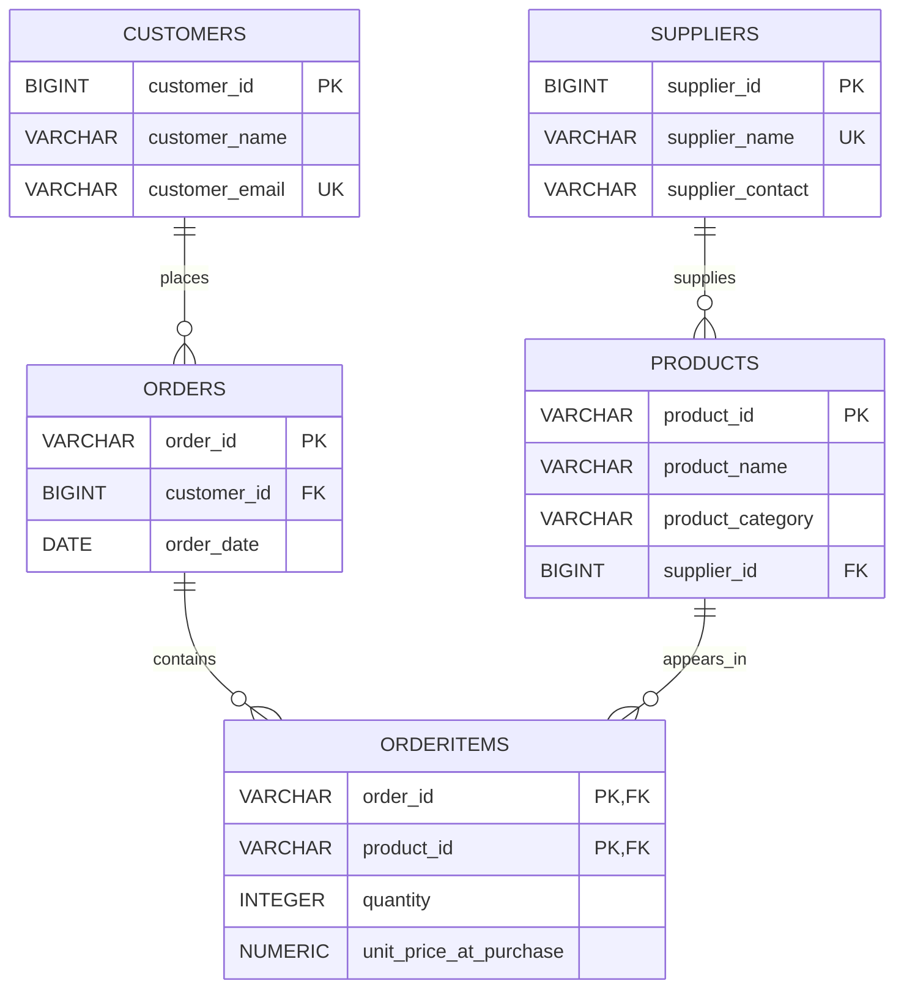

# ecommerce_project
AeroGlobal E-Commerce Database Design and PostgreSQL Implementation
# AeroGlobal E-Commerce Database Design

A relational database design project that transforms a flat e-commerce sales dataset into a structured, normalized PostgreSQL database using database normalization principles and relational modeling.

## 1. Project Overview

AeroGlobal is developing an in-flight e-commerce platform to manage customers, suppliers, products, and customer orders.

The initial business dataset was provided as a single CSV file containing customer information, product details, supplier information, and order transactions.

Storing all these details in one flat structure introduces data redundancy and creates potential insertion, update, and deletion anomalies.

The goal of this project is to analyze the original dataset, design a relational database normalized up to Third Normal Form (3NF), and implement its structure using PostgreSQL.

## 2. Project Objectives

- Understand the business data and identify its main entities.
- Review the existing flat file structure and identify redundancy issues.
- Explain Entity-Relationship Diagrams (ERDs) and database entities.
- Normalize the data up to Third Normal Form (3NF).
- Define primary keys and foreign key relationships.
- Implement the normalized database using PostgreSQL DDL.
- Apply data integrity constraints to maintain reliable records.

## 3. Source Dataset Overview

The original dataset is provided in `draft_schema.csv`.

It contains 20 order-line records and 11 columns.

### Dataset Fields

| Column | Description |
|---|---|
| OrderID | Unique identifier for an order |
| CustomerName | Customer's full name |
| CustomerEmail | Customer's email address |
| ProductID | Product identifier |
| ProductName | Product name |
| ProductCategory | Product category |
| SupplierName | Supplier's name |
| SupplierContact | Supplier contact information |
| OrderDate | Date the order was placed |
| Quantity | Number of units purchased |
| TotalPrice | Total price of the product line |

### Dataset Summary

| Metric | Count |
|---|---:|
| Total order-line records | 20 |
| Distinct orders | 15 |
| Distinct customers | 8 |
| Distinct products | 7 |
| Distinct suppliers | 5 |
| Distinct product categories | 6 |

## 4. Problems Identified in the Original Dataset

The original flat file structure contains repeated business information across multiple order lines.

The main issues include:

**Customer Data Redundancy:** Customer names and email addresses are repeated across multiple orders and product lines.

**Product Data Redundancy:** Product names and categories are repeated whenever the same product appears in different orders.

**Supplier Data Redundancy:** Supplier names and contact information are repeated across multiple products.

**Order Data Redundancy:** Order identifiers, customer information, and order dates are repeated when an order contains multiple products.

### Potential Data Anomalies

- **Update Anomaly:** A supplier contact change may require updating multiple records.
- **Insertion Anomaly:** New customers, suppliers, or products cannot be independently stored in the original flat structure without an order-line record.
- **Deletion Anomaly:** Deleting the last order line for a product may also remove the only stored information about that product and its supplier.

## 5. Database Design and Normalization

The original dataset is reorganized into five related tables.

The proposed relational schema consists of:

### 1. Customers

Stores customer information.

- Primary Key: `customer_id`
- Columns: `customer_id`, `customer_name`, `customer_email`
- Unique Constraint: `customer_email`

### 2. Suppliers

Stores supplier information.

- Primary Key: `supplier_id`
- Columns: `supplier_id`, `supplier_name`, `supplier_contact`
- Unique Constraint: `supplier_name`

### 3. Products

Stores product information and its associated supplier.

- Primary Key: `product_id`
- Foreign Key: `supplier_id`
- Columns: `product_id`, `product_name`, `product_category`, `supplier_id`

### 4. Orders

Stores customer order information.

- Primary Key: `order_id`
- Foreign Key: `customer_id`
- Columns: `order_id`, `customer_id`, `order_date`

### 5. OrderItems

Stores individual products included in each order.

- Composite Primary Key: (`order_id`, `product_id`)
- Foreign Keys: `order_id`, `product_id`
- Columns: `order_id`, `product_id`, `quantity`, `unit_price_at_purchase`

## 6. Entity Relationship Diagram (ERD)

The database relationships are designed as follows:



### Relationship Explanation

- One customer can place multiple orders.
- One supplier can supply multiple products.
- One order can contain multiple order items.
- One product can appear in multiple order items.

The `OrderItems` table resolves the many-to-many relationship between Orders and Products.

## 7. Normalization Process

### First Normal Form (1NF)

Each row represents one order-product combination, and each column contains a single atomic value.

### Second Normal Form (2NF)

Customer, order, and product attributes are separated to eliminate partial dependencies on the composite order-product key.

### Third Normal Form (3NF)

Customer, supplier, product, and order information is stored in their respective tables, eliminating transitive dependencies between non-key attributes.

The resulting design reduces redundancy and improves data consistency and maintainability.

## 8. Important Design Decisions

### Surrogate Keys

The source dataset does not contain customer or supplier identifiers.

Therefore, generated identity keys are introduced for `customer_id` and `supplier_id`, while the original `OrderID` and `ProductID` values are retained.

### Order Item Pricing

The original `TotalPrice` represents the total amount for a product line rather than the unit price.

The unit price is calculated as:

`unit_price_at_purchase = TotalPrice / Quantity`

For example:

`30.00 / 2 = 15.00`

The line total can be calculated as:

`Quantity * unit_price_at_purchase`

Storing the unit price at purchase preserves the historical price even if the product's current price changes.

## 9. Technologies Used

| Technology | Purpose |
|---|---|
| PostgreSQL | Relational database management |
| Neon | Cloud-hosted PostgreSQL environment |
| SQL | Database definition and constraints |
| CSV | Source dataset |
| Markdown | Project documentation |
| Visual Studio Code | Development and editing environment |
| GitHub | Version control and project hosting |

## 10. SQL Implementation

The `schema.sql` file contains PostgreSQL `CREATE TABLE` statements for the five proposed relational tables.

It includes:

- Primary Key constraints.
- Foreign Key constraints.
- NOT NULL constraints.
- UNIQUE constraints.
- CHECK constraints for quantity and purchase price.
- Comments explaining relational integrity, transaction atomicity, and horizontal scalability considerations.

The script is intended to create the schema in a clean database environment. Existing tables should be inspected before running it.

### Transaction Integrity

Primary and foreign key constraints help enforce uniqueness and referential integrity.

Multi-step order placement should be executed within a PostgreSQL transaction using `BEGIN`, `COMMIT`, and `ROLLBACK` to ensure all-or-nothing execution.

### Scalability Considerations

The normalized structure establishes clear entity boundaries and relationships, providing a foundation for future database growth and potential horizontal scaling with suitable infrastructure.

## 11. Repository Structure

```text
ecommerce_project/
│
├── README.md
├── draft_schema.csv
├── stakeholder_explanation.md
└── schema.sql
```

## 12. Expected Outcomes

The proposed database architecture provides:

- Reduced data redundancy.
- Improved data consistency.
- Clear relationships between business entities.
- Better enforcement of data integrity.
- A maintainable relational database structure.
- A foundation for future e-commerce application development.

---

**Project:** AeroGlobal E-Commerce Database Design  
**Database:** PostgreSQL  
**Author:** Dr. Ghada Ali
